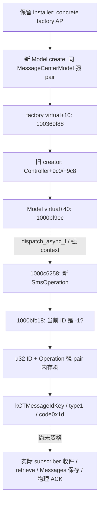

# SMS Controller 外部 owner 与通知 ID 生产链

**静态生产关联已推进到通知 payload：Controller+9c0 的 owner 是同源
`MessageCenterModel`，其队列构造独立 `SmsOperation`，分配/保存 operation ID，
再写入真实 `kCTMessageIdKey`。这不是 app 通知送达、Messages COMMIT 或物理 ACK 验收。**

分支 `feat/sms-notification-consumer`，基线 `ea32708b`，单代理。原件是现有 root clone
中的 CommCenter；本轮新读 header/commands/FS 均与保留资格相符，Mach-O UUID 为
`20b0ce28-18a1-3eea-aa2d-ef53e33c039a`。所有 Apple bytes、解码、reader/offset/exit
保存在 gitignored `x9/out/sms-notification-consumer-20261116/`，不修改 Apple 用户态。
没有生产代码 delta、测试/人工向量、compile/build、CI、构建后产物检查或设备动作。

## 1. Evidence → Finding → Path

| Evidence | Finding | 下一边 |
| --- | --- | --- |
| 新 direct BL `10036a00c → 1007ea650`；完整 supplier 316B；原 chain/RTTI | 入口是 `MessageCenterModelFactory` AP+10，retain/透传 x2 pair | 必须证明 supplier 的 caller，不能只由类型名补安装 |
| 旧 `call-provider-install/factory-install-functions.asm` 的原指令字；新 `1000bde4c..1000bf424` | 保留 installer 安装 factory AP 并调用 Model create；后者将同 Model 强 pair 传 factory+10 | 旧 installer 是保留原件派生证据，不冒充本轮新读/运行 |
| 原 Controller creator/consumer；新 Model AP+40、556B body、1200B queued operator | 同外部 owner 经自身弱锁/强 context 和 string copy 入队；新建独立 `SmsOperation` | 不把 Operation 说成原 `sms::Model` |
| 新 528B admission、两个8B get/set、120B base ctor；原 `MessageIdManager` RTTI/常量 | 当前 ID=-1 时分配 u32 counter，写 Operation+0xc，并按同 ID 存强 pair | 是内存 owner map，不是 SQL 或 durable COMMIT |
| 新 656B publisher、真实 CFString/imports、字典 leaf | 同 ID 零扩展成 XPC int64 写 `kCTMessageIdKey`；type=1；code=0x1d | fanout/subscriber 收件和同步 retrieve server 尚未闭 |

对应 F1（静态 owner 关联）、F2（独立 operation ID）、F3（通知 payload）分别引用以上
前两行、第三/四行、第五行；资格是静态代码/原数据，不是当前设备的 validated receipt。



图的箭头表示条件静态路径；不是保证每次调用、当前 provider 已选中或通知已送达。

## 2. 从 supplied pair 闭到外部 owner

旧 creator `1007ea650` 的 x2→sp+b8→Controller+9c0/+9c8 强 retain 已读，不重采。
本轮新单 target direct-BL lead 为 **10036a00c**，原 FS 完整 caller 为
**100369f88..10036a0c4 /316B**。其入口 x2 保存到 x22，再复制/retain 到 sp+8，
以 x2=&sp+8 调旧 creator。不是自己创建通知对象或裸指针默认值。

原 format6 actual chain **10154f180 → 100369f88**；AP **10154f170**，offset-to-top=0，
原 RTTI name **25MessageCenterModelFactory**，该 slot 是 +10。
对该 wrapper 的新 direct-BL 库存零命中，只说明没有新 direct call，不说明 dead code。

关键 caller 已在旧 `x9/out/call-provider-install/factory-install-functions.asm`：

- `100b936d4` 分配0x18；`100b936d8..100b936e0` 安装 AP10154f170。
- `100b93704` 把 factory 保存到 sp+20；`100b93714..100b93720` 以 x1=&factory、
  x0=原 Registry pair、x2=&原 endpoint 调 **1000bde4c**。
- 本轮只由旧 LLVM raw instruction words 生成116B规范解码
  `root-factory-install.cached.{bin,asm,json}`；**没有重读 installer bytes**。
  旧 provider-install 合同 UUID 与当前 metadata 相符，但这不是新 per-byte freshness
  或 live-process 调用证据；LLVM 附带的错误 `boost::archive...` 标签不作函数名。

新 **1000bde4c..1000bf424 /5592B** 创建0x110对象，安装 AP **101528d10**，
原 RTTI **18MessageCenterModel**。其 typeinfo 的 base entry101528ed0 实际链指向
**27MessageCenterModelInterface**，offset_flags=2（public、offset0）。

`1000be3c4..1000be3ec` 生成同对象的 returned strong pair；后续 x25 恢复到该 out-pair
地址。`1000be73c..1000be75c` 复制/retain 同 pair 到 sp+90，`1000be780..1000be798`
把它作为 x2 交给实际 factory virtual+10。结合上面的 installed factory、supplier 与
旧 creator，这闭合了 **同 MessageCenterModel pair → Controller+9c0/+9c8** 的静态同源。
并不自动保证当前 runtime 选中了这一路 factory。

## 3. Model 队列、内容复制与新的 Operation

旧 Controller `1007f39c4..1007f3a24` 取 +9c0 object 调 virtual+40。
新 concrete AP+40 真 slot **101528d50 → 1000bf9ec..1000bfc18 /556B**：

- 保存原 SIM/w1 及内容参数；三处真实 `std::string` copy ctor 对输入作 own-copy。
- `1000bfa70..1000bfa80` 调真实 `std::__1::__shared_weak_count::lock`，失败走 trap，
  不是静默替换默认 owner。
- capture 包括 copied content、SIM、原附加参数和 owner/control；留强引用后，以
  Model+18 的 queue 调真实 **dispatch_async_f**，函数指针 **1000c6258**。

新 queued operator **1000c6258..1000c6708 /1200B** 从同 context 取 owner/SIM/内容，
`1000c6468` 构造0xe0对象，生成 ptr/control 强 pair，并把它交给同 owner 的
**1000bfc18**。其 ctor **10042c780..10042c8c8 /328B** 安装 AP **101561878**，
原 RTTI 是 **12SmsOperation**，**不是 sms::GSMModel / sms::C2KModel**。
Registry pair 与内容在 Operation 中 own-copy；不是把原 parser Model 指针塞进通知。

## 4. ID 分配与拥有关系

SmsOperation ctor 调 **101074578..1010745f0 /120B**，参数 this=operation+8、w3=-1。
base `101074598` 写 w3到base+4，即 **Operation+0xc/u32 初始化为-1**。

原 AP+30/+38 真 targets：

- **10042c948..10042c950 /8B**：读 Operation+0xc/u32。
- **10042c950..10042c958 /8B**：写 w1→Operation+0xc/u32。

admission **1000bfc18..1000bfe28 /528B** 在读取 ID 前还调用 Operation virtual+80
及外部 service virtual+10，副作用未穷尽；所以分配规则只对**此刻 getter 为-1**的分支
作断言，不由 ctor 初始化假定所有 callback 必定分配：

1. getter==-1：`1000bfc78..1000bfc94` 取同 owner+80 的 manager，读取 manager+8/u32
   为 w1，写回 w1+1，然后把旧 w1交 setter。
2. 再读 getter，保留同 ID/w20；复制/retain Operation 强 pair。
3. 按同 u32 ID 查询 owner+60 的树；新 node+20存ID，+28/+30接收同 ptr/control，
   tree size+68递增。已存在 key 的分支不替换旧 pair；不能称为无条件保存成功。
4. 返回该 w20；null Operation 的路径返回-1，不作通知成功处理。

owner ctor 的+80/+88 pair创建 concrete **MessageIdManager**，原 AP **1015c1b68**。
初始8B常量 `1010b2bc8 = 0x3b9aca0080000000` 写 manager+8：低u32为
**0x80000000**，另一个u32为0x3b9aca00。计数器本轮无强制 reset、人工向量或递增实验。
这只是原代码初值，不能拿它预测设备当前通知 ID。

必须分开的身份：

| 值 | 位置/资格 | 不能代替 |
| --- | --- | --- |
| SIM slot | 原 details+0 → sms::Model+8；queued w1 | notification ID |
| 原 PDU Model ID/u16 | sms::Model+34 | Operation ID、GUID、SQL RowID、MD token |
| Operation/notification ID/u32 | SmsOperation+0xc；manager+8；owning map key | durable record、native epoch |
| Messages GUID/SQL RowID | 此轮未连接到成功 record | 上述任意整数 |

## 5. 同 ID 写到真实通知键

queued operator `1000c6504` 调 admission，返回值仍保留为 w21。
`1000c658c..1000c65a4` 保留原 SIM，只有 w21!=-1 才将 SIM/w1、同 ID/w2传给
**1000c2938..1000c2bc8 /656B**。

SIM==1 时，该函数：

- `1000c29c8` 以 `mov w0,w19` 零扩展原 u32 ID，再调真 **xpc_int64_create**。
- actual-chain slot10156b740→CFString10163ad10→真实文本 **kCTMessageIdKey**。
- slot10156b768→CFString10163adb0→真实文本 **kCTMessageTypeKey**；其值为1。
- `1000c0694..1000c0770 /220B` 将 CFString 转真实 std::string，leaf
  **1000188f4..10001893c /72B** 调真 **xpc_dictionary_set_value**，不只构造中间数值。
- 同 Registry 强 pair、code **0x1d** 和该 dictionary 进入
  **1000c0770..1000c0830 /192B**。它可调 servicemap recipient virtual+28，之后直达
  **100b7366c..100b736c8 /92B** 的 envelope/fanout wrapper。
- 所有 SIM 的共同尾还调用 owner+90 的 virtual+20，带原 SIM 与同 ID。

这里已证明通知 payload 的 ID 生产同源，**没有资格深层 envelope/fanout、owner+90
recipient的最终实现或 app receipt**，也不单凭0x1d给事件命名。
前轮 app-side 的通知uint→同步 `kSmsMessageID` 请求→CTMessage.messageId链保留；
两轮组合仍缺当前收件/同 ID retrieve server、退休规则与 GUID→成功record证据。

## 6. 实际范围、异常与复核

本轮最终 **18个新完整函数合11552B**，code/data read均≤1024B，9个exact imports。
最终合同 **notification-consumer-contract-r2.json**；r1保留，补120B base ctor及两个
owner/copy imports后使用r2。命令清单 **actual-reader-commands-r2.json** 不是时间线；
精确先后在 `timeline.md`。

所有18个函数reader和selected-data/import reader实际exit0/stderr空。明确保留两项异常：

1. `messagecenter-create-inventory-r1` **exit1**，guard发现旧cached caller，**尚未扫描原
   text**；不是零命中。随后改为矿旧 LLVM caller，不重采。
2. `messagecenter-name-inventory-r1` **exit0但输出不合格**：bounded rfind失败被加1成0，
   生成越界/超长name lead。原 reader/巨大输出保留，不把exit0当资格。有效有限记录
   只留作 leads；两处selected32B name窗口、actual RTTI/chain独立资格，结论不依赖
   越界记录。修正的 bounded-name-r2 脚本**未执行**。

factory AP库存只扫描uncached words，因此两处新AP installer是destructor-like body；
初始cache pagegrep只认Capstone语法，漏了已保存的LLVM factory installer。后续all-format
BL mining纠正。这也解释额外304B/1260B候选body为何**未闭factory安装，不再扩展**；
这些样本计入18函数总数，但不用于短信业务语义。

全部函数采样用 `read-functions.py` 的r1内容；执行后原版保存在
`read-functions.r1.py`，当前文件仅修正cache-exclusion上界到完整text section，
**修正版未执行，不回写实际命令**。

离线复核不需要重新采样：

```bash
OUT=x9/out/sms-notification-consumer-20261116
cat "$OUT/notification-consumer-contract-r2.json"
cat "$OUT/timeline.md"
cat "$OUT/root-factory-install.cached.json"
cat "$OUT/root-sms-operation-id-get.asm" "$OUT/root-sms-operation-id-set.asm"
cat "$OUT/message-id-fields-r1-proof.json"
```

需要重放reader时，从 `actual-reader-commands-r2.json` 取**实际argv**与对应
`.exit.json/.stdout/.stderr`；使用新的唯一out副本适配脚本，不覆盖成功样本。原始函数
范围、每段offset/bytes、metadata比较在各 `.json` 与 `*.reads.jsonl`。不要无新证据
重跑库存或 malformed-name-r1；不要为纯文档重编成功END kernel。

## 7. 未完成与下一选择

1. 继续窄读 fanout实际 subscriber 与同ID retrieve server/内存map退休规则。
2. 接已有 app CTMessage.messageId到Messages GUID，追当前成功record/COMMIT/重开。
3. 导出本轮合同/报告供交接复核，不重采成功范围。

完整通话短信goal继续active：逐动作CALL record/Client/UUID/native退休、typed DIAL、
CallList/handover/双向DSP、Messages durable保存与物理MT ACK/MO对端均未验收。
最新有效END kernel仍41deaefb输入的
`x9/out/x9-call-end-native-owner-20261116/kernel.development.sweet`，此轮未改它。
